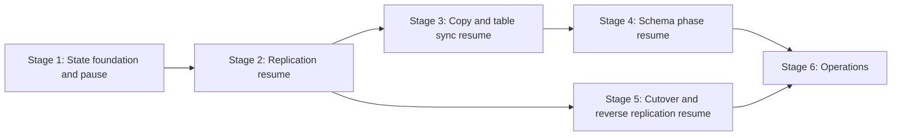
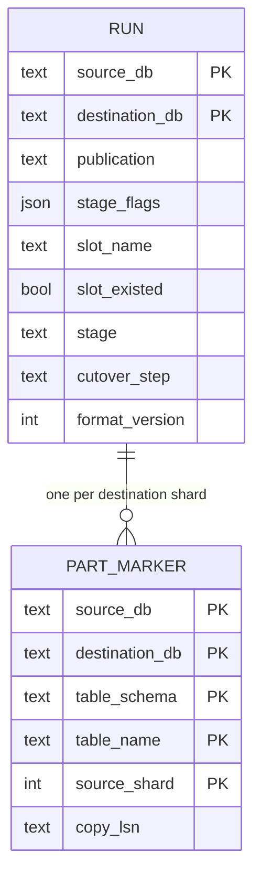
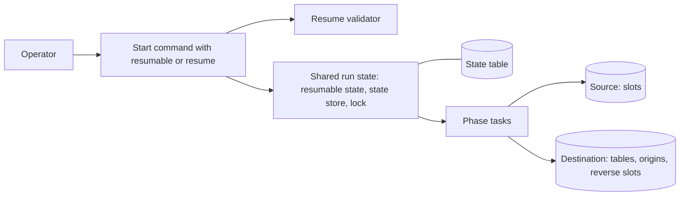
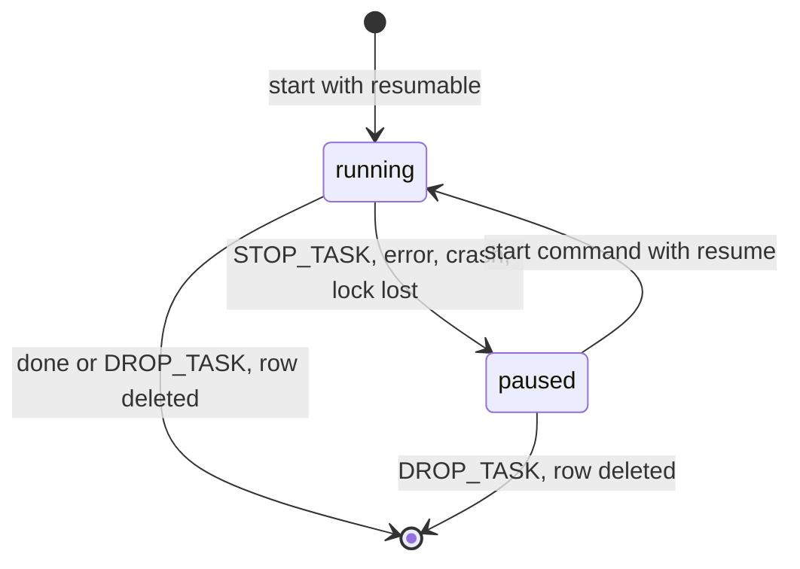
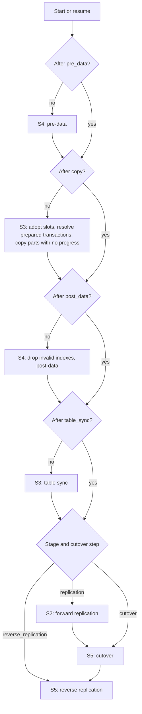
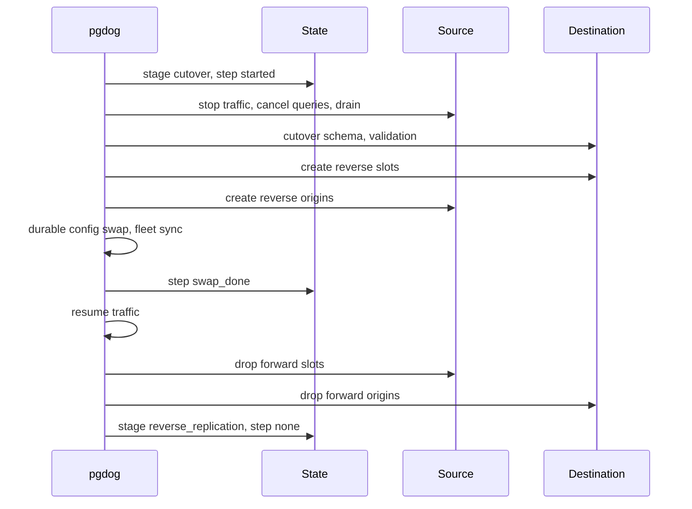

# Resumable resharding — design

This document describes the planned design for stoppable and resumable resharding. For the current pipeline see [RESHARDING.md](./RESHARDING.md).

Part 1 gives the plan. Part 2 gives the design that all stages share. Part 3 gives one section per implementation stage. Each stage describes the approach and the result, not the code changes.

"State" in this document means the data that pgdog saves for resume.

# Part 1. Plan

## Goal

Today a run lives only in pgdog memory. A stop or an error drops the slots and origins. A crash loses all progress.

The goal: a run that can stop, resume and survive a crash, in every phase.

## Selected inputs

|Topic|Selected input|
|---|---|
|State store|A Postgres table in the `pgdog` schema on destination shard 0 (SM1). The control plane Raft (SM2) was rejected. See "Storage mode".|
|Stored data|Only facts that Postgres does not store. Slots, origins and replication progress come from the catalogs.|
|Stop mode|A `resumable` flag on the start command. A resumable run never drops its slots on stop, error or crash. An abort command cleans up. Runs without the flag keep today's behavior.|
|Resume trigger|Manual command only. Startup only reports unfinished runs.|
|Copy unit|The table part: one source publication table from one source shard. Each part commits with 2PC on all destination shards, so a part is all or nothing. pgdog never truncates destination tables.|
|Copy mark|A marker row on each destination shard, written inside the copy transaction (shard marker). See Stage 3.|
|2PC owner|The resumable copy runs `PREPARE TRANSACTION` and `COMMIT PREPARED` itself. The existing 2PC `Manager` and its WAL are not used for resumable runs. The resume rules are the only recovery.|

**Note: 2PC is the only reliable way to copy a part. Without 2PC, a failure between shard commits leaves the part on some shards only, and a destination crash shortly after a commit can lose the part with no error. With 2PC, a part is all or nothing and durable on every shard.**

## Stages

Each stage is usable alone. A phase that is not resumable yet refuses resume. The operator can abort.

|Phase|S1|S2|S3|S4|S5|
|---|---|---|---|---|---|
|Pre-data schema|no|no|no|yes|yes|
|Slot creation|no|yes|yes|yes|yes|
|Copy|no|no|yes|yes|yes|
|Post-data schema|no|no|no|yes|yes|
|Table sync|no|no|yes|yes|yes|
|Forward replication|no|REPLICATE only|yes|yes|yes|
|Cutover|no|no|no|no|yes|
|Reverse replication|no|no|no|no|yes|

Integration tests are new scripts in the resharding integration suite. pgbench writes during each scenario.

# Part 2. Shared design

## Pipeline today

Phase order: pre-data schema, slot creation, copy, post-data schema, table sync, replication, cutover schema, validation, cutover, reverse replication. Stage flags (skip schema sync, replicate only, sync only, auto cutover) remove phases.

Facts that drive the design:

- The slot name is a user value or a random name. The random name is not stored.
- One permanent slot per source shard exists before the first table copy. It holds WAL for every later table snapshot.
- One origin exists per (slot, destination shard). Its name comes from the slot name and the shard. Today origins are dropped and created again, which loses apply progress.
- Each table part is copied from its own snapshot. Its copy LSN is the first skip watermark for replication.
- Sharded tables replay with a plain insert. Without origins and watermarks, a replay gives duplicate key errors.
- Every stop or error runs a cleanup that drops slots and origins.
- The cutover drops the forward slots before the config swap. The swap is in memory only.
- Each part copy runs in one transaction per destination shard. A failure before the commit rolls back every shard. Without 2PC, a failure between shard commits leaves the part on some shards only.
- Copy connections use `synchronous_commit = off`. A destination crash shortly after a copy commit can lose the copy with no error.
- When the cluster enables 2PC, the copy commits through the 2PC `Manager`. The `Manager` keeps its own WAL and runs its own recovery at startup. Its transaction names carry the instance id, not the run.

## Stored data

Rule: store a fact only when Postgres does not store it and resume needs it.

|Stored|Why resume needs it|Stage|
|---|---|---|
|Source and destination names|Run key. One unfinished run per pair.|1|
|Publication, stage flags, format version|Rebuild the run. Refuse a newer format.|1|
|Slot name|Find the slots and origins. A generated name is lost on crash.|1|
|"Slot existed before the run" flag|Abort must not drop a user slot.|1|
|Stage: last phase that started|Skip finished phases. Decide if a missing slot or origin means "create" or "refuse".|1|
|Copy progress per table part: copy LSN and completion|Skip complete parts. Resolve prepared transactions. Give watermarks to table sync and replication.|3|
|Cutover step: `none`, `started`, `swap_done`|Recover a crash inside cutover.|5|

|Not stored|Source of truth|
|---|---|
|Slots, origins, replication progress|`pg_replication_slots`, `pg_replication_origin`, confirmed flush, origin progress|
|Synced LSN per table|Not needed. After table sync, slots and origins cover every table.|
|Run status|Row exists: unfinished. Lock held: running. Lock free: paused. Completed and aborted runs delete the row.|
|Owner, heartbeat, fencing|The advisory lock. All writes use its connection.|
|Endpoints|Stage 5 finds the swap state from the location of the state table.|
|Publication list, shard counts|Resume compares them with the copy progress and the slot and origin counts.|
|Validation progress|Validation can run again safely.|
|Attempts, row counts, errors|Logs|

## Storage mode

Selected: SM1, a table in the `pgdog` schema on destination shard 0. It works in open source, enterprise and the CLI.

### Rejected: control plane Raft (SM2)

SM2 keeps the state in the Raft state machine of the enterprise control plane. A variant (SM3) uses SM1 in open source and SM2 in enterprise behind one interface.

SM2 needs Raft enabled in the control plane. Raft is off by default, and without it nothing is durable. Control plane features are stubs in open source, like `pgdog.nextval`. So SM2 makes resumable resharding enterprise only.

|Point|SM1|SM2|
|---|---|---|
|Editions|Open source, enterprise, CLI|Enterprise with Raft enabled|
|Writes to user databases|One state table on destination shard 0|None for the state. Shard markers stay on the destination.|
|Ownership|Advisory lock. Freed at once when the owner dies.|Lease. Takeover after the lease expires.|
|Availability|Depends only on the destination|Also depends on the control plane quorum|
|Swap detection|Location of the state table|Needs stored endpoints|
|Copy commit with a state mark|One local row write between prepare and commit|One Raft commit between prepare and commit. Blocks while the control plane is down.|
|Copy commit with a shard marker|No state write|No state write|

Both modes rely on 2PC for copy durability. Neither mode detects a part lost by a destination failover, unless Stage 3 selects the shard marker.

Why SM2 was rejected:

- Effort. The control plane Raft stores only sequences and maintenance mode today, with unconditional writes. SM2 needs new events, new Raft tables, a storage format upgrade, compare-and-set, a lease, fenced writes, a new control plane API and a pgdog client that renews the lease. SM1 needs one table and an advisory lock.
- Upgrade order. All control plane nodes must upgrade before pgdog uses the new state.
- Maintenance. Resharding and replication are open source. SM1 is still needed there, so SM2 means two backends with different ownership rules, two test sets, and changes in two codebases that must stay consistent.
- Availability. A control plane outage or a lost quorum pauses every resumable run, also when the databases are healthy.
- Takeover. After an owner crash, takeover waits one lease period. SM1 detects the crash at once.
- Fencing. The lease protects only the Raft state. A stale owner can still change Postgres until it stops itself.
- Maturity. Raft in the control plane is marked "Experimental".
- Copy commit. With a state mark, each part commit waits for a Raft write between prepare and commit. A control plane outage then leaves prepared transactions that hold locks on the destination.
- Config. The control plane does not store the pgdog config today. Config persistence after cutover (P4) is also new work.

Where SM2 would be better, and why it matters little:

|SM2 benefit|Why it matters little|
|---|---|
|No state table in user databases: no DDL, no dump exclusion.|pgdog already installs a `pgdog` schema on the shards. Shard markers stay on the destination in both modes.|
|A record of the run survives the loss of the destination.|No restore is possible. The copied data, origins and reverse slots are on the destination. The run must start again in both modes.|
|Maintenance mode already persists in Raft. After a crash, resume knows the real traffic state.|This works today without SM2. Resume can read it with no new storage.|
|One shared view of the run for all pgdog instances and the UI.|pgdog already pushes task updates to the control plane.|
|A lease survives short network breaks. The advisory lock ends on a short break.|The run pauses and can resume. No data is at risk.|

SM2 can be revisited if resumable resharding becomes an enterprise-only feature, or if the control plane gets a general state API for other features.

## State table (SM1)

Stage 3 records which table parts are copied in table `PART_MARKER`, one on each destination shard. Each shard inserts its marker inside its own copy transaction, so the marker commits or rolls back with the copied rows. It has no FK, because it lives on other databases than `RUN`.

`RUN` is one row per run, on destination shard 0.

Stage values: `pre_data`, `copy`, `post_data`, `table_sync`, `replication`, `cutover`, `reverse_replication`.

All slots use the stored name: one forward slot per source shard, one reverse slot per destination shard. Each slot has one origin on each shard of the other side. Each table part is its own redo unit.

The state store holds only `RUN`.

The state store creates its tables at run start with idempotent DDL. The existing `pgdog` schema setup does not run for every resharding run, so it is not enough. Format changes use additive DDL and the format version.

## Ownership

The owner holds a session advisory lock on the pair. It uses a dedicated state connection. Postgres frees the lock when the owner dies.

All state writes use this connection. A lost connection ends ownership. The owner then stops all tasks before any new side effect. A lease survives short network breaks, but it needs owner and expiry columns.

## Resumable run state

No new layer wraps the tasks. The resumable state lives in the shared run state that every resharding task already receives. Each task reads its own part of it.

|Job|Where it happens|
|---|---|
|Load or create the run row, take the lock|The start command with `resumable` or `resume`, before the task starts. The command puts the resumable state into the shared run state.|
|Hold the lock and the state connection|The shared run state. The lock lives until the run ends or pauses, not until the last copy of the state is dropped.|
|Skip finished phases|The resharding pipeline reads the stored stage.|
|Skip done parts, adopt slots, keep origins|Each phase task reads its part of the resumable state.|
|Stop, error or lock loss → pause|The existing cleanup paths check the resumable flag (Stage 1).|
|Validation|The start command with `resume`, before the task starts. One error per failed check.|
|"Resumed" flag in the UI|The task definition carries the flag. Subtasks show it too.|

Standalone COPY_DATA and REPLICATE runs get the same behavior, because they receive the same shared run state.

For each side effect, the state records what resume needs before the effect, or the effect proves its own progress. Resume completes or undoes each half-done effect.

## Commands

|Command|Behavior|Stage|
|---|---|---|
|RESHARD, COPY_DATA, REPLICATE with trailing `resumable`. CLI `data_sync --resumable`.|Starts a resumable run. Returns the task id and slot name. Fails if the pair has an unfinished run.|1|
|STOP_TASK|Pauses. Slots and origins stay. Traffic resumes if it was stopped.|1|
|`DROP_TASK <task id>`|Stops the run if it is active. Drops the slots the run created and all its origins. Deletes the row. Destination data stays.|1, reverse in 5|
|`SHOW TASKS`|Existing command. It also lists resumable runs: running or paused, stage, cutover step, lock holder, slot. Stage 6 adds slot WAL status and retained bytes.|1|
|RESHARD, COPY_DATA, REPLICATE with trailing `resume`. CLI `data_sync --resume`.|Continues the unfinished run of the pair. The command and its arguments must match the stored run, or it refuses. Takes the lock, validates, reconciles, continues. No new command.|2|
|CUTOVER|No change.|5|

After cutover the names point to swapped hosts. The commands search shard 0 of both clusters. Exactly one row must match.

## Known limits

- DDL or sharding changes during a pause are not detected.
- Runs without `resumable` lose progress on crash, as today.

# Part 3. Stages

## Stage 1. State foundation and pause

Goal: a resumable run never leaks slots or origins. The operator can see and abort it. No resume yet.

### Approach

1. Parse `resumable`. Without it, nothing changes.
2. Open the state connection, create the state table, take the lock. Fail if the pair has an unfinished run.
3. Commit the run row before the first slot exists: parameters, slot name, "existed" flag, stage.
4. Write the stage at each phase start.
5. On stop, error or lock loss: stop tasks, keep slots and origins, release the lock.
6. At run end: drop the slots the run created if needed. Delete the row.

Every automatic cleanup path skips resumable runs. Only abort and run end drop objects. Abort before slots exist deletes the row. After that, abort also drops the forward slots the run created and all forward origins.

Exclude the state table from the schema dump. A later run can use this destination as its source.

### Interface changes

- RESHARD, COPY_DATA and REPLICATE accept a trailing `resumable`. A slot named `resumable` needs the flag after it.
- CLI `data_sync --resumable`.
- New `DROP_TASK <task id>`, forward direction only. It aborts a resumable run.
- `SHOW TASKS` also lists resumable runs. pgdog lists each unfinished run in the state table as a task, also a paused run after a restart, so the run has a task id for `DROP_TASK`. A try-lock shows running or paused. The owner is shown by its instance id.
- New state table in the `pgdog` schema on destination shard 0.
- STOP_TASK on a resumable run pauses it and keeps its slots and origins.

### Tests

|#|Scenario|Expected result|
|---|---|---|
|1|RESHARD with `resumable`. STOP_TASK during replication.|Paused. Forward slots still exist.|
|2|DROP_TASK after 1.|Row gone. Run slots gone. A slot that existed before the run stays.|
|3|RESHARD without `resumable`. STOP_TASK.|Today's cleanup. No state row.|

Unit tests on a real Postgres: idempotent DDL, lock conflict, write failure after the lock connection is lost.

Result: a stopped run shows paused with its slots, and abort drops exactly the slots the run created.

### Open questions

- Name of the abort command: `DROP_TASK` or `RESET_TASK`.

## Stage 2. Replication resume

Goal: a resumable REPLICATE run survives stop and crash. It continues from slot confirmed flush with no duplicate apply.

### Approach

What exists when a start command with `resume` runs:

|Source|Data|
|---|---|
|State table|Publication, stage flags, slot name, "slot existed" flag, stage, cutover step, format version|
|Source catalog, per source shard|The slot, its confirmed flush position and its WAL status|
|Destination catalog, per destination shard|The origin and its progress: the last source commit applied on that shard|
|Config|The source and destination clusters and their shard counts|

Nothing from the old process survives: no task tree, no in-memory state, no open streams.

How resume rebuilds the run:

1. Find the run row and take the lock. If another instance holds the lock, refuse.
2. Validate: known format, matching shard counts, every slot present with its WAL, every origin present.
3. Build the shared run state from the stored data: same publication, slot name and stage flags. Slot ownership comes from the stored "existed" flag, because every slot now exists.
4. Adopt the slots by name. Create only the origins that are missing (before stage `table_sync`). Never reset origin progress.
5. Load the publication tables. Set each table's watermark from its stored copy LSN (Stage 3). A REPLICATE run has no copy, so its watermarks start at zero.
6. Start a new task with the "resumed" flag, at the stored stage.

How replication continues without duplicates:

- Each stream starts from its slot. Postgres starts at the slot's confirmed flush position. pgdog moves that position only after every destination shard has made the change durable, so no change after it is lost.
- Postgres can send again the changes between the confirmed flush position and the last change applied on a shard. Each destination shard skips every transaction at or below its origin progress.
- Each shard updates its origin in the same transaction as the applied changes. Origin progress and data therefore always agree on each shard.
- Changes for a table at or below its copy LSN are skipped, because the copy already has them.

Write stage `replication` after the origins exist.

### Interface changes

- RESHARD, COPY_DATA and REPLICATE accept a trailing `resume`. No new command. The command, the publication and the slot name must match the stored run, or the command refuses. A slot named `resume` needs the flag after it.
- CLI `data_sync --resume`.
- Origins of resumable runs keep their progress across restarts.
- A resumed task shows a "resumed" flag in the UI. Its subtasks show it too.

### Rules

- Slot: reuse if present. Create if missing and no part has copy progress. Refuse in all other cases, or if its WAL is lost.
- Origin: create if missing before stage `table_sync`. Refuse if missing from `table_sync` on.
- Validator: the lock is free, the format version is known, shard counts match, required slots and origins exist. On failure, only abort is possible.

A RESHARD run needs copy LSNs as watermarks. Stage 3 stores them. Until then, only REPLICATE runs resume.

### Tests

|#|Scenario|Expected result|
|---|---|---|
|4|SIGKILL during REPLICATE replication. Restart. Resume.|Paused before resume. Origin progress does not go back. No duplicate keys. Data check passes.|
|5|A second instance resumes an owned run.|Refused with the lock holder.|

Unit tests: creating an existing origin keeps its progress. The validator refuses a missing slot and lost WAL.

Result: forward replication resumes after stop or crash with no duplicates.

### Open questions

- Synced LSNs: we assume they are not needed after table sync. If a test shows duplicates, store a synced LSN per part.

#### Task state across attempts

The exact behavior is not decided yet.

Facts:

- The pgdog task registry is in memory. Task ids start again after a restart.
- The control plane keeps task updates in memory, per token, instance and process run.
- After a crash, the old task sends no final update. The UI can show it as running.
- A resumed run starts a new task tree with new ids and new progress counters.
- A run can be resumed by another pgdog instance, or by an instance with another token. The control plane does not show tasks across tokens.

Needs:

- Link all attempts of one run. The link must not depend on the instance, the token or the task id. The run key (source, destination) in the state table, or a run id stored in the run row, can be this link.
- Show that a task is resumed, and which attempt it continues.
- End the old attempt in the UI (for example "interrupted") when the run is resumed or aborted.
- Show done parts as done, not as zero progress.
- Decide whether progress counters are restored. Restored counters need more stored data.

## Stage 3. Copy and table sync resume

Goal: COPY_DATA and RESHARD survive a stop or crash during copy and table sync. Complete parts are not copied again. pgdog never truncates destination tables.

### Interface changes

- No new commands.
- The copy always uses 2PC on a multi-shard destination, independent of the client 2PC setting. The destination needs `max_prepared_transactions > 0`.
- The resumable copy runs `PREPARE TRANSACTION` and `COMMIT PREPARED` directly. It does not register with the 2PC `Manager`. The transaction name is `__pgdog_rsh_<run>_<part>_<attempt>_<shard>`. `Manager` recovery must not touch this prefix, and the resume rules must not touch `Manager` names.
- A single-shard destination commits each copy with synchronous commit on.
- Copy progress is stored in a marker table on each destination shard (shard marker).
- A start command with `resume` accepts runs stopped in copy, table sync and replication, also RESHARD runs.
- `DROP_TASK` also rolls back the prepared transactions of the run.

### Marking a part complete

To know what is done, resume needs these facts for each part (source publication table, source shard):

|Data|Where|Written when|
|---|---|---|
|Part key: source table schema, source table name, source shard|Shard marker row|With the commit decision|
|Copy LSN|Same row|Same time. It is the watermark for table sync and replication, and it identifies the attempt.|
|Commit decision|A committed marker on any shard|After all shards prepare, before the first commit|
|Prepared transactions|`pg_prepared_xacts` on each destination shard. The name holds the run, the part and the attempt.|By Postgres, at `PREPARE TRANSACTION`|

Nothing else is stored per part. Row counts and attempts are in the logs only.

Resume reads these facts and gives each part one status:

|Status|Facts|Action|
|---|---|---|
|Done|Commit decision exists, no prepared transaction left|Skip. Use its copy LSN.|
|Committing|Commit decision exists, prepared transactions left|`COMMIT PREPARED` on the remaining shards. Then done.|
|Not done|No commit decision. Prepared transactions may exist.|`ROLLBACK PREPARED` on all shards. Copy again.|
|Lost|Markers on some shards, none on others, no prepared transaction|A failover lost data. Refuse.|

A destination table with rows and no done part for any source table that maps to it has rows from outside the run. Refuse. The check runs per source relation, as the copy does today.

A part is one (source publication table, source shard). Child partitions of a partitioned table are separate parts, each with its own copy LSN, also when they map to one destination parent. Its rows come only from that source shard, so each part is its own redo unit. "Complete" must never be true while a shard lacks the data.

Each part is one transaction per destination shard. All shards get the copy, also with no rows. The commit uses 2PC:

1. `PREPARE TRANSACTION` on all destination shards. The transaction name identifies the run, the part and the attempt.
2. `COMMIT PREPARED` on all shards.

Postgres flushes `PREPARE TRANSACTION` and `COMMIT PREPARED` to disk, also with `synchronous_commit = off`. So a committed part is complete and durable on every shard.

Each shard inserts a marker (source table, source shard, copy LSN) in its copy transaction. A committed marker on any shard proves the commit decision, because `COMMIT PREPARED` starts only after all shards prepare. No state write happens between prepare and commit, so the commit depends on the destination only.

|Failure|Destination|Action|
|---|---|---|
|F1: crash before all shards prepare|No shard committed|Roll back prepared transactions. Copy again.|
|F2: crash after all shards prepare, before the first commit|No shard committed|No marker: roll back, copy again.|
|F3: crash during `COMMIT PREPARED`|Some shards committed|Markers on some shards: commit the remaining shards.|
|F4: connection lost during `COMMIT PREPARED`|Unknown on one shard|Resolved as F3|
|F5: failover to an async standby after commit|Part can be missing on one shard|Markers missing on that shard. Refuse.|

Without truncate, a part that a failover lost cannot be copied again, because its rows on other shards stay. Resume can only detect the loss and refuse. The operator then decides.

The marker table is a new object on each shard. Exclude it from the dump and from `FOR ALL TABLES` publications.

Rules:

- Resolve all prepared transactions of the run with the status table before any copy starts.
- Each attempt has a new copy LSN.
- Prepared transactions that a crash leaves behind hold locks and the transaction horizon on the destination until resume or abort.

### Approach

1. Check `max_prepared_transactions` on the destination shards.
2. Resolve the prepared transactions of the run with the rules above.
3. Load publication tables and copy progress. After the copy stage, refuse if a table has no progress or progress exists for a removed table.
4. Check that tables with no complete part have no rows.
5. Copy the parts with no progress. Commit each part with 2PC and record its progress.
6. Give the copy LSNs of all complete parts to table sync and replication.
7. Create missing origins. Write `table_sync`. Run table sync.

A redone part gets a later copy LSN. The forward slot is older, so replay covers every change.

On stop, pgdog commits or rolls back its own prepared transactions. After a crash, the next resume or abort resolves them. Abort otherwise works as in Stage 1.

### Tests

|#|Scenario|Expected result|
|---|---|---|
|6|STOP_TASK during copy. Resume.|Complete parts not copied again. No truncate. Data check passes.|
|7|SIGKILL during copy. Restart. Resume.|As 6. No prepared transactions remain. The source slot count does not grow.|
|8|Pause after copy. Add a table to the publication. Resume.|Refused.|
|13|Kill pgdog after all shards prepare, before the first `COMMIT PREPARED`. Resume.|Rolled back and copied again. Data check passes.|
|14|Kill pgdog after shard 0 commits, before shard 1. Resume.|Shard 1 committed. Part not copied again. Data check passes.|
|15|Kill a destination Postgres right after a part commits. Restart it. Resume.|The part is still there. Data check passes.|

Unit tests: the resolve rule for each mix of prepared, committed and missing shards. Shard markers commit and roll back with the data.

Result: a copy crash never copies complete parts again, never truncates, leaves no prepared transactions, and RESHARD runs resume in replication.

### Open questions

- Schema exclusion: we found no exclusion of the `pgdog` schema in publication lists or apply. Unverified. If none exists, exclude the state and marker tables.

## Stage 4. Schema phase resume

Goal: RESHARD with schema sync resumes in every forward phase.

### Approach

Most schema statements already skip objects that exist. Foreign keys come only in post-data. The one gap: a crash during a concurrent index build leaves an INVALID index, and a rerun skips it.

- Skip pre-data and post-data when the stored stage is past them.
- Pre-data and validation: run again.
- Post-data: drop INVALID indexes on publication tables on all destination shards. Then run again.

### Interface changes

None. A start command with `resume` accepts runs stopped in schema phases.

### Tests

|#|Scenario|Expected result|
|---|---|---|
|9|SIGKILL during a concurrent index build. Resume.|No INVALID index stays.|

Result: every forward phase of RESHARD is resumable.

### Open questions

None.

## Stage 5. Cutover and reverse replication resume

Goal: a crash at any cutover step is recoverable. Reverse replication resumes.

Today cutover drops the forward slots before the config swap. A crash between them loses data. The swap is in memory only, so a restart reads the old config.

### Interface changes

- `DROP_TASK` works in the reverse direction.
- The state stores the cutover step.
- The config swap survives a restart (with P1, P2 or P4), or resume prints the needed change (P3).
- CUTOVER is unchanged.

### Approach

New cutover order. Forward slots stay until the swap is durable. The existing traffic stop, cutover schema, reverse slot creation and fleet hooks stay.

The state table is on destination shard 0. Before the swap, pgdog finds it through the destination name. After the swap, through the source name. This shows the swap state with no stored endpoints.

|Step|Live config|Resume action|
|---|---|---|
|`started`|Not swapped|Release fleet traffic. Drop reverse objects. Back to forward replication.|
|`started`|Swapped|Write `swap_done`. Continue below.|
|`swap_done`|Swapped|Release traffic. Drop forward slots and origins. Start reverse replication.|
|`swap_done`|Not swapped|Refuse. The swap was not durable.|
|Any|Neither side|Refuse. The operator fixes the config.|

A failed durable swap or fleet sync reverts the swap, sends traffic to the source and pauses. A rollback cutover uses the same steps in reverse. Reverse replication resumes like forward replication. A missing reverse slot or origin means refuse.

Stop at `started` releases traffic and pauses. Abort at `started` also drops reverse objects and the forward objects the run created. After `swap_done`, stop keeps reverse slots, and abort drops all remaining objects.

### Config persistence

|Option|How|Pros|Cons|
|---|---|---|---|
|P1|Rewrite config files with a temporary file and rename|Restart reads the right config|Loses comments. Fails on read-only mounts.|
|P2|On startup, apply `swap_done` runs from the state|Works with read-only config|Startup needs the database|
|P3|Refuse on mismatch and print the needed change|No new write path|Manual step after each such crash|
|P4|Control plane stores the config|Hook exists|Enterprise only|

### Reverse slot timing

|Option|When|Pros|Cons|
|---|---|---|---|
|R1|Before the swap, traffic stopped|Rollback path exists before the first new write. A crash before the swap only drops reverse objects.|Both slot sets exist for a short time.|
|R2|After `swap_done`, before traffic resumes|Fewer stale objects|A crash between them leaves no rollback path. Resume may stop traffic again.|

### Tests

|#|Scenario|Expected result|
|---|---|---|
|10|Fail after reverse slots exist, before the swap. Resume.|Traffic on source. Reverse objects dropped. Cutover runs again later.|
|11|Fail after `swap_done`, before the forward drop. Resume.|Traffic on destination. Forward slots dropped. Reverse replication runs.|
|12|DROP_TASK in reverse.|Row gone. No run slots or origins on either cluster.|

Result: an injected failure at each cutover step, then resume, ends in the action of the cutover table.

### Open questions

- Config persistence: P1, P2, P3 or P4. Not decided. With P3, a restart after `swap_done` serves the old source until the operator fixes the config. Writes made in that window sit in the forward slots. Resume at `swap_done` must then drain the forward slots before it drops them, or P3 is not safe.
- Reverse slot timing: R1 or R2.
- The enterprise release-traffic hook can run alone after a restart. Unverified. If not, resume refuses and asks the operator to release maintenance mode.
- Postgres allows forward and reverse slots at the same time. If a slot limit blocks R1, use R2.

## Stage 6. Operations

### Interface changes

- Startup warning for each unfinished run.
- Slot WAL status and retained bytes in SHOW TASKS. A paused run keeps its slot, and the slot holds WAL.

Tests: second-instance resume for every stage.

Result: all scenarios of Stages 1 to 5 pass.

### Open questions

None.
