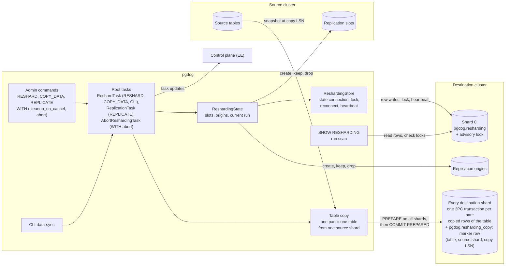
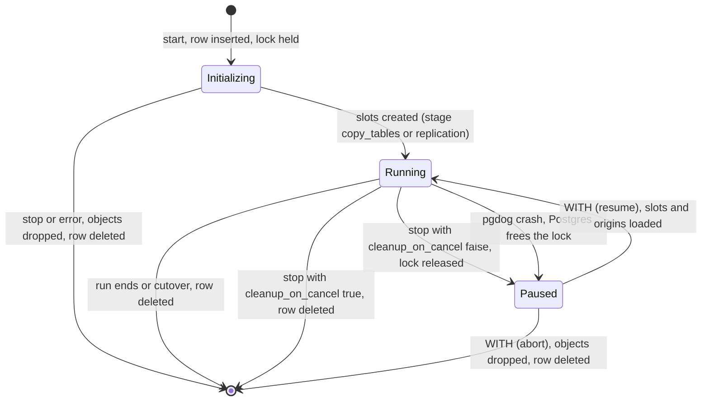
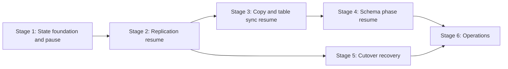
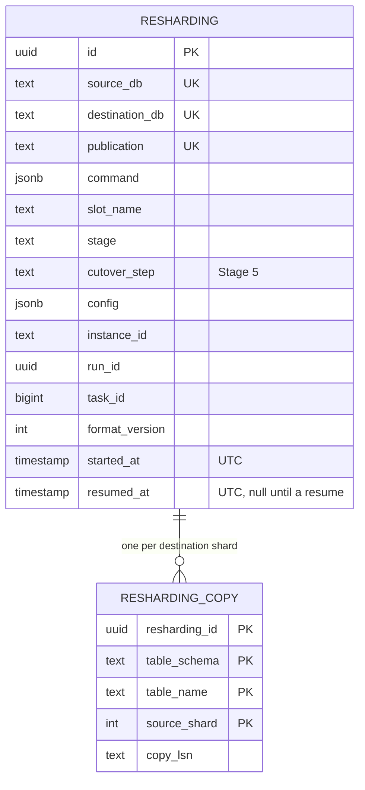
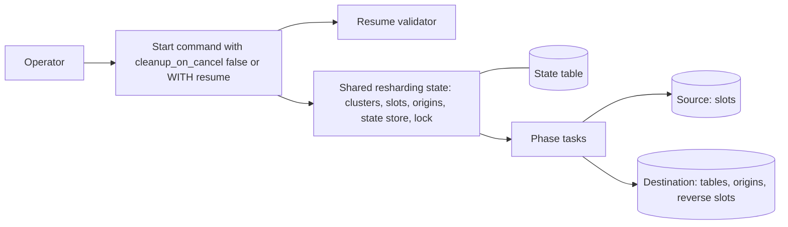
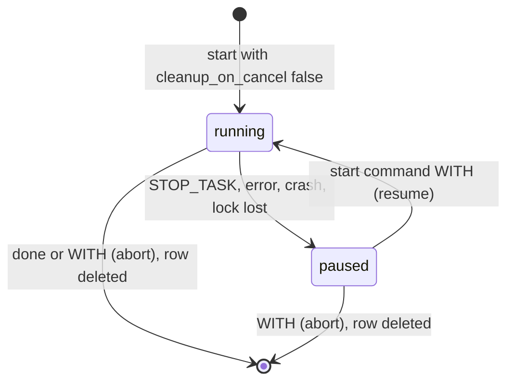
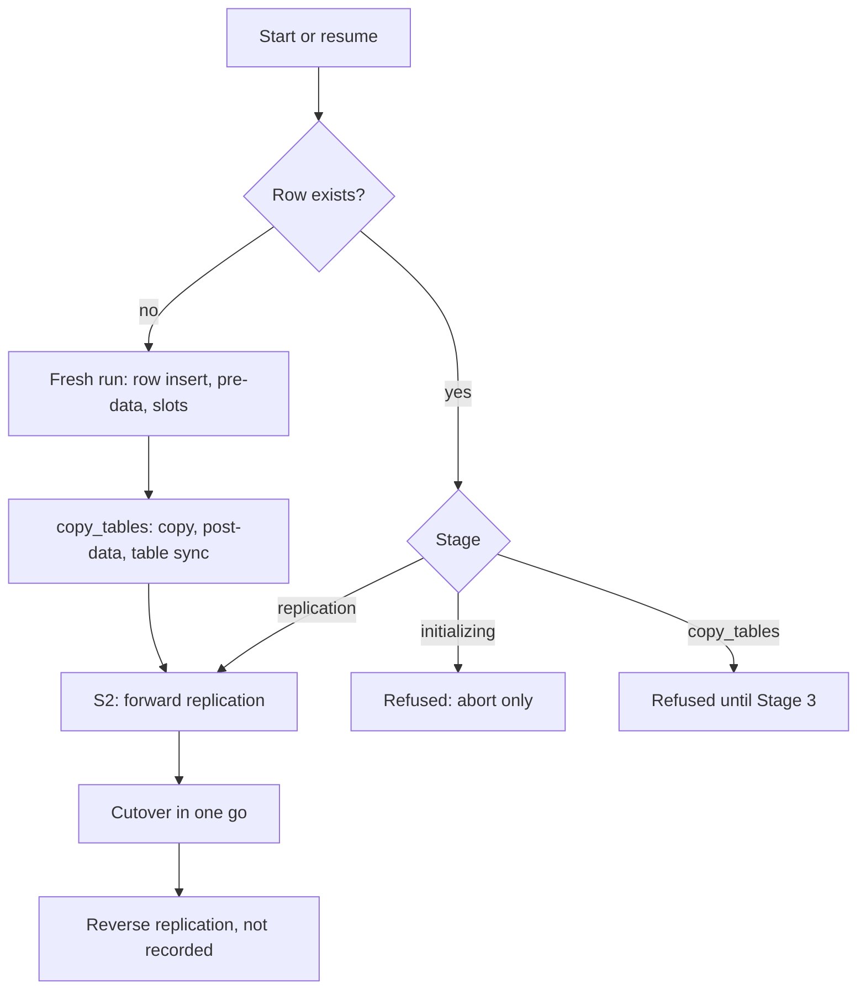
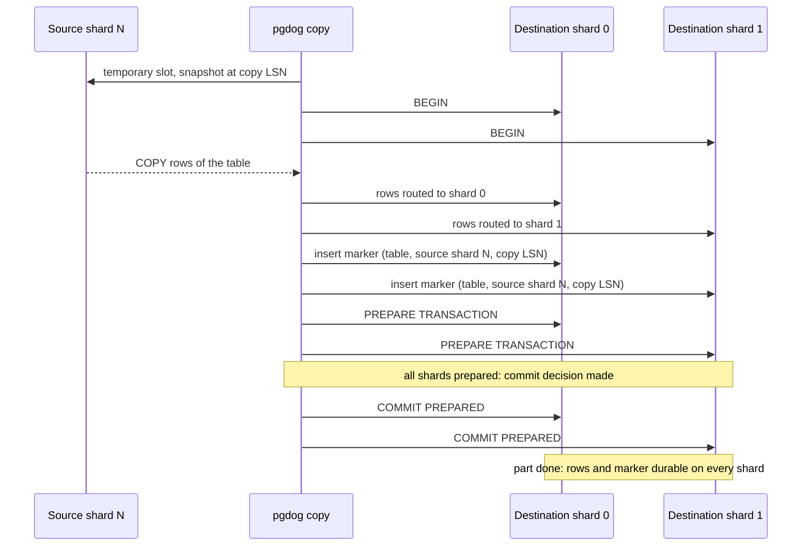
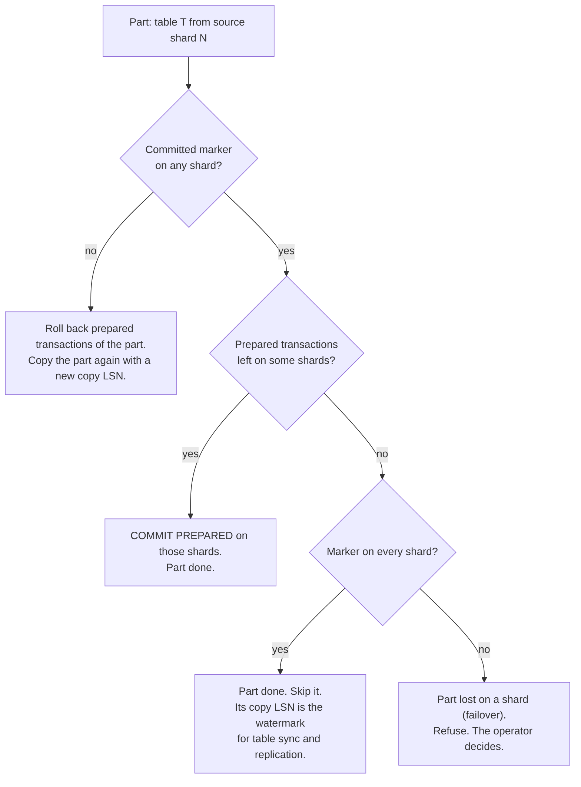
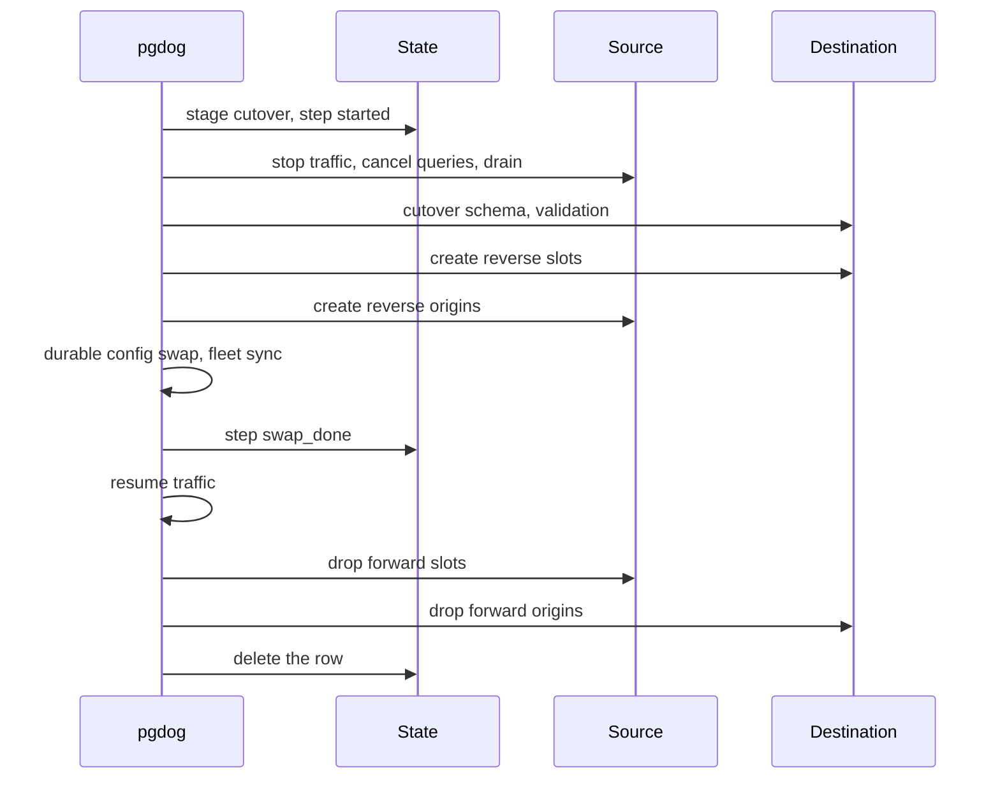

# Resumable resharding — design

This document describes the design for stoppable and resumable resharding. Stage 1 is implemented. The later stages are planned. For the current pipeline see [RESHARDING.md](./RESHARDING.md).

The Overview gives a short picture of the design. Part 1 gives the plan. Part 2 gives the design that all stages share. Part 3 gives one section per implementation stage. Each stage describes the approach and the result, not the code changes.

"State" in this document means the data that pgdog saves for resume.

|Stage|Status|
|---|---|
|1. State foundation and pause|Implemented.|
|2. Replication resume|Implemented for REPLICATE runs and replicate-only RESHARD runs. Runs that copied data are refused until Stage 3.|
|3. Copy and table sync resume|Planned.|
|4. Schema phase resume|Planned.|
|5. Cutover recovery|Planned.|
|6. Operations|Planned.|

# Overview

This section gives a short picture of the design: the parts, how they connect, the run states, and the main tradeoffs. Stage 1 is implemented. The copy parts come with Stage 3. Part 2 and Part 3 give the details. The table copy is described in Stage 3.

## How it works

Every resharding run (RESHARD, COPY_DATA, REPLICATE) writes one row to the table `pgdog.resharding` on destination shard 0. The row holds the facts that Postgres does not store: the command and its options, the slot name, the stage, a snapshot of the sharding config, and the owner task. Postgres already stores the slots, the origins and the replication progress, so the row does not copy them.

The run owns its row through a session advisory lock on the run key (source, destination, publication). The lock lives on a dedicated state connection. All state reads and writes use this connection. A held lock means that the run is running. A row with a free lock means that the run is paused or crashed.

The copy (Stage 3) adds the table `pgdog.resharding_copy` on every destination shard. Each copied part writes its marker row to this table in the same 2PC transaction as its rows, so the destination itself records which parts are done.

The option `cleanup_on_cancel` decides what a stop does. With `true` (the default), a stop drops the slots that the run created and all its origins, and deletes the row, as before. With `false`, a stop after `initializing` keeps the slots, the origins and the row, so the run can resume later or the operator can abort it.

## Parts and relations

| Part | Role |
|---|---|
| Admin commands and CLI | Start a run, choose `cleanup_on_cancel`, or abort a stopped run with `WITH (abort)`. |
| Root tasks | `ReshardTask` and `ReplicationTask` start the run and decide on cleanup when they end. Subtasks (copy, schema sync) share the same run state. `AbortReshardingTask` cleans up a stopped run. |
| Table copy | Copies each part from its own source snapshot. In Stage 3, commits each part with 2PC on all destination shards, together with its marker row. |
| `ReshardingState` | Shared by all tasks of one run. Holds the slots, the origins and the current run. Decides what a stop keeps or drops. |
| `ReshardingStore` | Owns the state connection and the lock. Reconnects and takes the lock again after a lost connection. Runs the heartbeat while the run lives. |
| `pgdog.resharding` | One row for each unfinished run, on destination shard 0. |
| `pgdog.resharding_copy` (Stage 3) | One table on each destination shard, with one marker row for each copied part (table, source shard, copy LSN). Every part writes its marker on every destination shard, so all shards hold the same rows. The marker is written in the same transaction as the part's rows, so it commits or rolls back with them. |
| `SHOW RESHARDING` | Reads the rows of every configured database and shows each run as running or paused, from the lock state. |
| Control plane | Gets the task definitions and status, as for other tasks. It is not the store of the state. |

## Run states

A crash in `initializing` also leaves a paused row. Abort then drops every slot with the run's name.

## Pros and cons

**Pros**

- Works in open source, enterprise and the CLI. Needs only the destination database.
- Postgres frees the lock when the owner session ends. No lease logic in pgdog.
- Any pgdog instance can see a stopped run and abort it, so slots never leak.
- Copy parts are all or nothing on every shard, so resume never copies a done part again and never truncates.

**Cons**

- Adds pgdog tables to the user's destination shards.
- The lock gives no fencing: between a lost connection and the relock, another instance can take the lock.
- A paused run keeps its slots, and the slots hold source WAL until resume or abort.
- The resumable copy needs 2PC on the destination (`max_prepared_transactions > 0`).

# Part 1. Plan

## Goal

Today a run lives only in pgdog memory. A stop or an error drops the slots and origins. A crash loses all progress.

The goal: a run that can stop, resume and survive a crash, in every phase.

## Selected inputs

|Topic|Selected input|
|---|---|
|State store|The Postgres table `pgdog.resharding` on destination shard 0 (SM1). The control plane Raft (SM2) was rejected. See "Storage mode".|
|Stored data|Only facts that Postgres does not store. Slots, origins and replication progress come from the catalogs.|
|Stop mode|The option `cleanup_on_cancel`, default `true`, keeps today's behavior. With `cleanup_on_cancel false`, the run is resumable. A resumable run never drops its slots on stop, error or crash. `WITH (abort)` cleans up.|
|Resume trigger|Manual command only. There is no startup scan. `SHOW RESHARDING` reports unfinished runs, and a new resharding logs the other runs on its destination.|
|Copy unit|The table part: one source publication table from one source shard. Each part commits with 2PC on all destination shards, so a part is all or nothing. pgdog never truncates destination tables.|
|Copy mark|A marker row on each destination shard, written inside the copy transaction (shard marker). See Stage 3.|
|2PC owner|The resumable copy runs `PREPARE TRANSACTION` and `COMMIT PREPARED` itself. The existing 2PC `Manager` and its WAL are not used for resumable runs. The resume rules are the only recovery.|

**Note: 2PC is the only reliable way to copy a part. Without 2PC, a failure between shard commits leaves the part on some shards only, and a destination crash shortly after a commit can lose the part with no error. With 2PC, a part is all or nothing and durable on every shard.**

## Stages

Each stage is usable alone. A phase that is not resumable yet refuses resume. The operator can abort.

|Phase|S1|S2|S3|S4|S5|
|---|---|---|---|---|---|
|Pre-data schema|no|no|no|yes|yes|
|Slot creation|no|yes|yes|yes|yes|
|Copy|no|no|yes|yes|yes|
|Post-data schema|no|no|no|yes|yes|
|Table sync|no|no|yes|yes|yes|
|Forward replication|no|REPLICATE only|yes|yes|yes|
|Cutover|no|no|no|no|yes|
|Reverse replication|no|no|no|no|no|

Integration tests are new scripts in the resharding integration suite. pgbench writes during each scenario.

# Part 2. Shared design

## Pipeline today

Phase order: pre-data schema, slot creation, copy, post-data schema, table sync, replication, cutover schema, validation, cutover, reverse replication. Stage flags (skip schema sync, replicate only, sync only, auto cutover) remove phases.

Facts that drive the design:

- The slot name is a user value or a random name. The random name is not stored.
- One permanent slot per source shard exists before the first table copy. It holds WAL for every later table snapshot.
- One origin exists per (slot, destination shard). Its name comes from the slot name and the shard. Today origins are dropped and created again, which loses apply progress.
- Each table part is copied from its own snapshot. Its copy LSN is the first skip watermark for replication.
- Sharded tables replay with a plain insert. Without origins and watermarks, a replay gives duplicate key errors.
- Every stop or error runs a cleanup that drops slots and origins.
- The cutover drops the forward slots before the config swap. The swap is in memory only.
- Each part copy runs in one transaction per destination shard. A failure before the commit rolls back every shard. Without 2PC, a failure between shard commits leaves the part on some shards only.
- Copy connections use `synchronous_commit = off`. A destination crash shortly after a copy commit can lose the copy with no error.
- When the cluster enables 2PC, the copy commits through the 2PC `Manager`. The `Manager` keeps its own WAL and runs its own recovery at startup. Its transaction names carry the instance id, not the run.

## Stored data

Rule: store a fact only when Postgres does not store it and resume needs it.

|Stored|Why resume needs it|Stage|
|---|---|---|
|Source and destination names, publication|Run key. One unfinished run per key.|1|
|Command with its options, format version|Rebuild the run. Refuse a newer format.|1|
|Slot name|Find the slots and origins. A generated name is lost on crash.|1|
|Stage: `initializing`, `copy_tables` or `replication`|Tells which slots and origins the row describes, and whether the copy is finished.|1|
|Config snapshot: shard counts and sharding rules of both clusters|Detect a config change before resume|1|
|Copy progress per table part: copy LSN and completion|Skip complete parts. Resolve prepared transactions. Give watermarks to table sync and replication.|3|
|Cutover step: `none`, `started`, `swap_done`|Recover a crash inside cutover.|5|

|Not stored|Source of truth|
|---|---|
|Slots, origins, replication progress|`pg_replication_slots`, `pg_replication_origin`, confirmed flush, origin progress|
|Synced LSN per table|Not needed. After table sync, slots and origins cover every table.|
|Run status|Row exists: unfinished. Lock held: running. Lock free: paused. Completed and aborted runs delete the row. A cutover also deletes the row.|
|Owner and heartbeat|The advisory lock. All writes use its connection. The lock does not fence a lost owner, see Ownership.|
|Endpoints|Stage 5 finds the swap state from the location of the state table.|
|Publication list, shard counts|Resume compares them with the copy progress and the slot and origin counts.|
|Validation progress|Validation can run again safely.|
|Attempts, row counts, errors|Logs|

## Storage mode

Selected: SM1, a table in the `pgdog` schema on destination shard 0. It works in open source, enterprise and the CLI.

### Rejected: control plane Raft (SM2)

SM2 keeps the state in the Raft state machine of the enterprise control plane. A variant (SM3) uses SM1 in open source and SM2 in enterprise behind one interface.

SM2 needs Raft enabled in the control plane. Raft is off by default, and without it nothing is durable. Control plane features are stubs in open source, like `pgdog.nextval`. So SM2 makes resumable resharding enterprise only.

|Point|SM1|SM2|
|---|---|---|
|Editions|Open source, enterprise, CLI|Enterprise with Raft enabled|
|Writes to user databases|One state table on destination shard 0|None for the state. Shard markers stay on the destination.|
|Ownership|Advisory lock. Freed when the owner session ends. After a host or network failure, TCP keepalive ends the session in about 2 minutes.|Lease. Takeover after the lease expires.|
|Availability|Depends only on the destination|Also depends on the control plane quorum|
|Swap detection|Location of the state table|Needs stored endpoints|
|Copy commit with a state mark|One local row write between prepare and commit|One Raft commit between prepare and commit. Blocks while the control plane is down.|
|Copy commit with a shard marker|No state write|No state write|

Both modes rely on 2PC for copy durability. Neither mode detects a part lost by a destination failover, unless Stage 3 selects the shard marker.

Why SM2 was rejected:

- Effort. The control plane Raft stores only sequences and maintenance mode today, with unconditional writes. SM2 needs new events, new Raft tables, a storage format upgrade, compare-and-set, a lease, fenced writes, a new control plane API and a pgdog client that renews the lease. SM1 needs one table and an advisory lock.
- Upgrade order. All control plane nodes must upgrade before pgdog uses the new state.
- Maintenance. Resharding and replication are open source. SM1 is still needed there, so SM2 means two backends with different ownership rules, two test sets, and changes in two codebases that must stay consistent.
- Availability. A control plane outage or a lost quorum pauses every resumable run, also when the databases are healthy.
- Takeover. After an owner crash, takeover waits one lease period. SM1 detects the crash at once.
- Fencing. The lease protects only the Raft state. A stale owner can still change Postgres until it stops itself.
- Maturity. Raft in the control plane is marked "Experimental".
- Copy commit. With a state mark, each part commit waits for a Raft write between prepare and commit. A control plane outage then leaves prepared transactions that hold locks on the destination.
- Config. The control plane does not store the pgdog config today. Config persistence after cutover (P4) is also new work.

Where SM2 would be better, and why it matters little:

|SM2 benefit|Why it matters little|
|---|---|
|No state table in user databases: no DDL, no dump exclusion.|pgdog already installs a `pgdog` schema on the shards. Shard markers stay on the destination in both modes.|
|A record of the run survives the loss of the destination.|No restore is possible. The copied data, origins and reverse slots are on the destination. The run must start again in both modes.|
|Maintenance mode already persists in Raft. After a crash, resume knows the real traffic state.|This works today without SM2. Resume can read it with no new storage.|
|One shared view of the run for all pgdog instances and the UI.|pgdog already pushes task updates to the control plane.|
|A lease survives short network breaks. The advisory lock ends on a short break.|The run pauses and can resume. No data is at risk.|

SM2 can be revisited if resumable resharding becomes an enterprise-only feature, or if the control plane gets a general state API for other features.

## State table (SM1)

Stage 3 records which table parts are copied in the table `pgdog.resharding_copy` (`RESHARDING_COPY`), one on each destination shard. Each shard inserts its marker inside its own copy transaction, so the marker commits or rolls back with the copied rows. It has no FK, because it lives on other databases than `RESHARDING`. It refers to the run by `resharding_id`. A marker from an earlier run with the same key has another id, so a new run never reads it as its own.

The primary key of `RESHARDING` is `id`, a UUID v7 that pgdog generates when it creates the row. A resume keeps the id. The key (source, destination, publication) is `UNIQUE`: lookup and the advisory lock use it, and it allows one unfinished run per key. Stage updates, resume and delete find the row by `id` only. A stale owner thus cannot change the row of a newer run with the same key. The owner columns (`instance_id`, `run_id`, `task_id`) name the root task of the attempt that wrote the row.

`RESHARDING` is the table `pgdog.resharding`. It has one row per unfinished resharding, on destination shard 0. The row describes the resharding and every object it keeps.

Stage values: `initializing`, `copy_tables`, `replication`. The row is inserted when the run starts, with `initializing`. The copy path writes `copy_tables` after all forward slots exist. Replication writes `replication` after all forward slots and origins exist. While the stage is `initializing`, a stop or an error drops the slots that the run created and all its origins, and deletes the row, also with `cleanup_on_cancel false`. Cutover deletes the row, so the reverse phase has no row and is never resumed. A resume refuses a row in `initializing`, so a resume never creates a slot: a missing slot is an error.

All slots use the stored name: one forward slot per source shard. Reverse slots use the same name, but no row describes them. Each slot has one origin on each shard of the other side. Each table part is its own redo unit.

The state store holds only `RESHARDING`.

The state store creates its tables at run start with idempotent DDL. The existing `pgdog` schema setup does not run for every resharding run, so it is not enough.

### Format changes

Two layers change separately: the table shape and the meaning of a row.

Table shape. The DDL file runs at every state store open, under a transaction advisory lock. Changes are appended to it as idempotent statements. The destination role needs CREATE on the database, also when the schema and the table exist.

- Add columns only, and always with a default. Older pgdog versions name their columns, so they ignore new columns, and their inserts still work.
- Never drop, rename or retype a column. Stop using it instead.
- The primary key never changes. A key change needs a new table and a format version bump.

Row meaning. Each row stores the format version of the pgdog that wrote it.

|Change|Version bump|Rule|
|---|---|---|
|New option in the command or a new field in the config snapshot JSON|No|The field has a serde default. Older versions ignore a new command option. A new config field makes an older version report the config as changed, see the config snapshot rules.|
|New column with a default|No|See the table shape rules.|
|New stage value or cutover step, or a field with a new meaning|Yes|An older pgdog refuses the row. It does not resume or abort a resharding it cannot read.|
|A newer pgdog reads an older row|No|The row parser fills the defaults of the newer format.|

`SHOW RESHARDING` and the check at resharding start read the key columns first. A row that this version cannot read still shows its key, with the reason. It does not hide the other rows.

## Ownership

The owner holds a session advisory lock on the run key (source, destination, publication). It uses a dedicated state connection. Postgres frees the lock when the owner session ends. After a host or network failure, TCP keepalive on the state session ends it in about 2 minutes, with the `[resharding] tcp` defaults.

All state reads and writes use this connection. When a query on it fails and leaves the connection unusable, the store drops the connection, waits `[resharding] retry_delay` (default 1 s), opens a new one, takes the lock again and runs the query again. It repeats this up to `[resharding] retry_max_attempts` times (default 10, `0` retries forever). A SQL error on a usable connection goes to the caller with no reconnect, so the lock stays. A lock held by another session also goes to the caller at once. A dropped connection sends `Terminate` when its socket still works, so the old backend ends and frees the lock before the relock waits out `lock_timeout`. Only when the network fails in one direction can the old backend keep the lock until its keepalive ends it; then the relock fails with `ReshardingLocked`, the run stops, and the operator resumes it. When the attempts run out, the query returns the last error, and its caller handles it as before. When a run starts, its store also starts a heartbeat: a query every `[resharding] state_heartbeat_interval` (default 5 s) through the same path, so a lost lock is taken back even when the run writes nothing. The heartbeat ends when the store drops. It stops the run's root task only when another session holds the lock. While the state connection cannot be restored, for example while destination shard 0 is down, it logs a warning and tries again at the next interval. Stopping would not help: no other session can take the lock while its shard is down, and replication has its own retry budget. A connection that hangs without an error ends at the socket on both sides. `[resharding] tcp` sets the TCP settings of all resharding connections, in place of `[tcp]`. The state connection also sets them on its Postgres session as `tcp_keepalives_*` and `tcp_user_timeout`. The default is keep-alive after 60 s idle, every 15 s, 4 probes, and a user timeout of 2 minutes, so a hung connection ends in about 2 minutes. `TCP_USER_TIMEOUT` and the keep-alive count work only on Linux. The lock gives no fencing: between the loss and the relock, the old owner can still apply changes, while another instance can take the free lock, for example to abort. A lease survives short network breaks, but it needs owner and expiry columns.

## Resumable run state

No new layer wraps the tasks. The resumable state lives in the shared run state that every resharding task already receives. Each task reads its own part of it.

|Job|Where it happens|
|---|---|
|Take the lock, check the key, insert the row|The first step of the reshard or replication task takes the lock and refuses a key with a row. Then it inserts the row with stage `initializing`. The start command replies with the task id first, so a duplicate key fails the task with `ReshardingExists`, visible in `SHOW TASKS`. The task puts the resumable state into the shared run state.|
|Hold the lock and the state connection|The shared run state. The lock lives until the run ends or pauses, not until the last copy of the state is dropped.|
|Skip finished phases|The resharding pipeline reads the stored stage. A row at `copy_tables` cannot resume until copy progress exists (Stage 3).|
|Adopt slots, keep origins|Before it takes the row, the resume loads the stored slots and their origins into the shared run state. Replication then finds them and creates nothing.|
|Stop, error or lock loss → pause|The existing cleanup paths check the resumable state (Stage 1).|
|Validation|The command checks the row, the command kind, the slot and the lock before it registers the task, so errors return at once. The task then validates again under the lock: the full command, the slot, the config snapshot, the stage, every slot and every origin.|
|"Resumed" marker in the UI|The task definitions `reshard` and `replication` carry `resumed`: the run id that the task continues. It is empty for a new run.|

Standalone COPY_DATA and REPLICATE runs get the same behavior, because they receive the same shared run state.

For each side effect, the state records what resume needs before the effect, or the effect proves its own progress. Resume completes or undoes each half-done effect.

## Commands

|Command|Behavior|Stage|
|---|---|---|
|RESHARD, COPY_DATA, REPLICATE `WITH (cleanup_on_cancel false)`. CLI `data-sync --cleanup-on-cancel false`.|Starts a resumable run. The reply does not change. The task fails if the key (source, destination, publication) has an unfinished resharding. Each other publication on the same pair has its own resharding.|1|
|STOP_TASK|Pauses. Slots and origins stay. Traffic resumes if it was stopped.|1|
|RESHARD, COPY_DATA, REPLICATE `WITH (abort)`. CLI `data-sync --abort`.|The key is (source, destination, publication). The command kind must match the stored row: RESHARD and COPY_DATA are one kind, REPLICATE is another. The options of the command are not compared. The slot must match when it is given. The config snapshot is not checked. Abort only cleans up a paused or crashed run before the cutover. After the cutover, the run has no row, and abort fails. If the run holds the lock, abort refuses with an error and the run continues. Stop the run first with `STOP_TASK` on the instance that owns it. The abort runs as a registered task, `abort <command> <source> -> <destination>` in `SHOW TASKS`. It drops every slot with the run's name, all its origins and the row. Destination data stays. Admin returns the task id. The CLI waits for the task.|1|
|`SHOW TASKS`|Existing command. No change.|1|
|`SHOW RESHARDING`|New command. It lists every unfinished resharding from the state tables. Columns: `source`, `destination`, `command`, `publication`, `stage`, `state`, `instance`, `task_id`, `replication_slot`, `started_at`, `resumed_at`. Stage 6 adds slot WAL status and retained bytes.|1|
|RESHARD, COPY_DATA, REPLICATE `WITH (resume)`. CLI `data-sync --resume`.|Continues the paused or crashed resharding with the same key (source, destination, publication). The command kind and the slot must match the stored row. Without a slot argument, the stored slot is used. A running run refuses with the lock owner. The task then checks the full command and the config snapshot. `resume` together with `abort` or `cleanup_on_cancel` is refused. The reply does not change. COPY_DATA replies with the stored slot.|2|
|CUTOVER|No change.|5|

Abort and resume search shard 0 of the destination. A cutover deletes the row, so no row is on the source side after the config swap. Stage 5 adds the search on the source side.

## Known limits

- Sharding changes during a pause are detected through the config snapshot. DDL changes are not detected.
- A run with the default `cleanup_on_cancel true` that crashed keeps its row, slots and origins, and it can resume. A run with `cleanup_on_cancel true` that stopped normally deleted its row and cannot resume.
- Only REPLICATE runs and replicate-only RESHARD runs (for example `data-sync --replicate-only`) resume. Other RESHARD and COPY_DATA runs are refused with "copied tables, and a copy cannot resume yet" until Stage 3.
- Each resharding needs its own slot name. Two reshardings with the same explicit slot name on one source share the slots: one run can consume changes the other needs, and abort or cleanup of one drops the slots of the other. Their origins also share names on a destination server, so they share apply progress. Generated slot names never collide.
- `data-sync --abort` always aborts a RESHARD row. Abort a REPLICATE run with the admin command `REPLICATE ... WITH (abort)`.
- Abort builds the slot and origin names from the current shard counts. If the shard count changed during a pause, drop the remaining slots and origins by hand.
- A hard crash inside cutover, after the row delete, can leave slots with no row. Drop them by hand.
- A failed forward slot or origin drop in cutover does not stop the cutover. The remaining forward slots keep source WAL until the operator drops them by hand.
- The reverse phase after a cutover is not resumable. A stop or an error in the reverse phase drops the reverse slots and origins, also with `cleanup_on_cancel false`. To replicate in the reverse direction again, start REPLICATE.

# Part 3. Stages

## Stage 1. State foundation and pause

Goal: a resumable run never leaks slots or origins. The operator can see and abort it. No resume yet.

In this stage, "resumable run" means a run with `cleanup_on_cancel false`. "Cancel" covers every way a run stops before it ends: `STOP_TASK`, an error, a shutdown, a crash and a lock held by another session.

### Approach

1. Parse `cleanup_on_cancel`. The default is `true`. The flag decides only what happens on stop or error. Every run is recorded.
2. Open a dedicated state connection to destination shard 0. Create `pgdog.resharding` with idempotent DDL. Take the session advisory lock on the key (source, destination, publication) with `pg_advisory_lock`. The connection's `lock_timeout` is `[resharding] state_heartbeat_interval` (default 5 s), so a run waits that long for an old session to end, then fails. Fail if the key has a row.
3. Probe the slots before the run creates them. If all slots exist, the run reuses them, and a live run keeps them on stop. If only some slots exist, refuse.
4. Capture the config snapshot: the shard counts and sharding rules of both clusters.
5. Insert the row right after the key check: command with its options, publication, slot name, stage `initializing`, config snapshot, owner task (instance id, run id, task id), format version, start time. While the stage is `initializing`, a stop or error always drops the slots that the run created and all its origins, deletes the row and releases the lock, also with `cleanup_on_cancel false`. After a crash in `initializing`, the row stays, and abort drops every slot with the run's name.
6. Write `copy_tables` when the copy path has created all forward slots. Write `replication` when replication has all forward slots and origins. A write never moves the stored stage back.
7. Every `[resharding] state_heartbeat_interval` (default 5 s) the store runs a heartbeat query on its state connection. A state query that leaves the connection unusable reconnects, takes the lock again and runs again, up to `[resharding] retry_max_attempts` times with `retry_delay` between attempts. A hung connection ends at the socket in about 2 minutes. The run stops only if another session holds the lock. A heartbeat that cannot reconnect logs a warning and tries again at the next interval.
8. On stop, error, shutdown or lock loss, with `cleanup_on_cancel false`: stop tasks, keep slots and origins, release the lock. With `true`: drop the slots that the run created and all its origins, then delete the row and release the lock. A broken state connection reconnects as in step 7. If the drop fails, or another instance holds the lock, the row stays, so abort can finish the cleanup. After a crash, Postgres frees the lock and the row stays.
9. Cutover ends the run, with no resume point inside it: delete the row and release the lock, drop the forward slots and origins, then create the reverse slots. A failed row delete stops the cutover before any slot is dropped, so the run keeps its slots and pauses or cleans up as in step 8. A failed forward drop does not stop the cutover. pgdog logs a warning, and the operator drops the remaining forward slots and origins by hand. A crash inside cutover is not resumable. The reverse phase has no row and no lock, so abort and resume after the cutover fail with `NoResharding`. A stop or an error during reverse replication drops the reverse slots and origins, also with `cleanup_on_cancel false`.
10. At the end of a run with no cutover, delete the row.

Before the cutover, every automatic cleanup path skips runs with `cleanup_on_cancel false`. For them, only abort and the normal run end drop objects.

Abort runs as the registered task `AbortReshardingTask`. Admin and CLI use the same task. `SHOW TASKS` lists it, and `STOP_TASK` can stop it. The command finds the row by its key (source, destination, publication). Before the task starts, the command checks the row: the command kind, the slot when it is given, and the lock. A mismatch, or a lock that a running run holds, is an error at once. Abort never stops a run, on this instance or on another one. The task takes the lock, so a run that starts again between the check and the task makes the task fail with the same error. Then the task drops every slot with the run's name, all its origins and the row. This includes slots that existed before the run: after abort, nothing can be continued. Each phase skips missing objects, so a failed abort can run again. Abort does not check the config snapshot.

The config snapshot holds the shard counts and the `sharded_tables`, `sharded_mappings`, `omnisharded_tables` and `sharded_schemas` entries of both databases, as the serde JSON of the config structs. The compare reads the stored entries with the current config structs, and a field that a stored entry lacks reads as its default. So an upgrade that adds a config field does not report a change. Config fields are never removed or renamed between versions. A downgrade is different: `sharded_tables` and `sharded_mappings` refuse unknown fields, so an older pgdog reports a newer field as a change and refuses the resume. This is intended, because the older pgdog cannot apply that field. Resume is supported only between close pgdog versions. Every field is critical. Shard hosts are not stored: a failover or a DNS change keeps the same databases. The stored slots and origins prove that the databases are the same. Stage 1 stores the snapshot only. Stage 2 compares it with the live config and refuses a resume on a mismatch.

`SHOW RESHARDING` reads the state table on shard 0 of each configured database at query time. A held lock in `pg_locks` means `running`, no lock means `paused`. The scan never takes the lock. `instance` is the instance that started or last resumed the run. `task_id` is its root task while the run is running, so `STOP_TASK` on that instance stops it. It is null while the run is paused, because task ids are valid only in the process that created them. When a resharding starts, it checks its own key (an existing row refuses a fresh start; a resume checks the command, slot and config). It then reads the rest of its destination's state table: a running row is logged as in progress, a paused row gets a warning as an unfinished resharding.

Exclude the state table from the schema dump. A later run can use this destination as its source.

### Interface changes

- RESHARD, COPY_DATA and REPLICATE accept the option `cleanup_on_cancel <bool>`, default `true`. `WITH (cleanup_on_cancel false)` starts a resumable run. A bare `cleanup_on_cancel` means `true`. Accepted values: `true`, `false`, `on`, `off`.
- RESHARD and REPLICATE now accept `WITH (...)` options, as COPY_DATA does. The replies do not change.
- RESHARD, COPY_DATA and REPLICATE accept `WITH (abort)`. It aborts the unfinished resharding with the key (source, destination, publication) of the command, before the cutover. The reply is one column `task_id`, the abort task. `abort` together with `cleanup_on_cancel` is refused. COPY_DATA refuses `abort` with `tables_only`.
- CLI `data-sync --cleanup-on-cancel <true|false>` (default `true`) and `data-sync --abort`. `--abort` conflicts with `--cleanup-on-cancel`, `--replicate-only`, `--tables-only`, `--sync-only` and `--skip-schema-sync`.
- `SHOW TASKS` does not change for reshard and replication tasks. The abort task shows as `abort <command> <source> -> <destination>`.
- New `SHOW RESHARDING`. Columns: `source`, `destination`, `command`, `publication`, `stage`, `state`, `instance`, `task_id`, `replication_slot`, `started_at`, `resumed_at`. `task_id` is null while the run is paused. `resumed_at` is null until the first resume. A row that this version cannot read shows its key and `unsupported: <error>` in `state`. A state table that cannot be read shows `error: <error>` in `state`, the database names that share it in `destination`, and null in the other columns.
- No startup scan. `SHOW RESHARDING` lists each unfinished resharding. A new resharding logs each other unfinished resharding on its destination.
- Control plane: a new field `cleanup_on_cancel` on the reshard and replication definitions. A missing field reads as `true`. A new definition kind `abort_resharding`. The abort task reports the generic task status. All changes are additive.
- New table `pgdog.resharding` on destination shard 0. `pg_dump` in schema sync excludes it.
- The state connection uses `application_name` `pgdog_resharding:<instance_id>`. It holds the advisory lock `(hashtext('pgdog.resharding'), hashtext('<source>/<destination>/<publication>'))`. The first half is the namespace of all resharding locks.
- Before the cutover, STOP_TASK on a resumable run pauses it and keeps its slots and origins. STOP_TASK on a run with `cleanup_on_cancel true` drops its slots and origins as today, then deletes its row. After the cutover, STOP_TASK drops the reverse slots and origins for every run.
- Every run, also with the default `cleanup_on_cancel true`, writes a row and takes the lock. A second run with the same key is refused while the first one runs or has a row.

### Tests

|#|Scenario|Expected result|
|---|---|---|
|1|COPY_DATA `WITH (cleanup_on_cancel false)`. STOP_TASK during replication.|Paused in `SHOW RESHARDING`, also after a restart. Forward slots and origins still exist.|
|2|`WITH (abort)` after 1.|Row gone. All slots with the run's name and all its origins gone, also slots that existed before the run.|
|3|REPLICATE with the default `cleanup_on_cancel true`. STOP_TASK.|A row while it runs. On stop, today's cleanup, then the row is deleted.|

Unit tests on a real Postgres: lock conflict with the owner name, writes reconnect and take the lock again after the lock connection is lost, the relock waits for the lock holder, writes with an old row id, writes after a failed relock. Unit tests for the config validator. An integration test proves that the cutover deletes the row and releases the lock, that abort after the cutover fails, and that a stop during reverse replication drops the reverse slots and origins.

Result: a stopped run shows paused with its slots, and abort drops every slot and origin of the run.

## Stage 2. Replication resume

Goal: a resumable REPLICATE run survives stop and crash. It continues from slot confirmed flush with no duplicate apply.

### Approach

What exists when a start command with `WITH (resume)` runs:

|Source|Data|
|---|---|
|State table|Command with its options, publication, slot name, stage, config snapshot, format version|
|Source catalog, per source shard|The slot, its confirmed flush position and its WAL status|
|Destination catalog, per destination shard|The origin and its progress: the last source commit applied on that shard|
|Config|The source and destination clusters and their shard counts|

Nothing from the old process survives: no task tree, no in-memory state, no open streams.

How resume rebuilds the run:

1. The command builds the run state in resume mode. Before it registers the task, it reads the row and checks the command kind, the slot and the lock. A held lock refuses with the lock owner. Without a slot argument, the run takes the stored slot.
2. The task takes the lock and reads the row again. It validates the full command, the slot, the config snapshot and the stage.
3. It loads the slots and the origins in parallel. Every slot must exist and still have its WAL. Every origin must exist. The resume never creates a slot or an origin, and never resets origin progress.
4. Only after these checks, the task writes the new owner and `resumed_at`. A failed check leaves the row unchanged and releases the lock.
5. The loaded slots and origins go into the shared run state. Replication finds them and skips creation. A resumed run is always resumable: a stop or an error keeps its slots, origins and row.
6. A REPLICATE run has no copy, so its table watermarks start at zero. A replicate-only RESHARD run runs its pre-data and post-data schema sync again. Both skip existing objects.

How replication continues without duplicates:

- Each stream starts from its slot. Postgres starts at the slot's confirmed flush position. pgdog moves that position only after every destination shard has made the change durable, so no change after it is lost.
- Postgres can send again the changes between the confirmed flush position and the last change applied on a shard. Each destination shard skips every transaction at or below its origin progress.
- Each shard updates its origin in the same transaction as the applied changes. Origin progress and data therefore always agree on each shard.
- Changes for a table at or below its copy LSN are skipped, because the copy already has them.

A resume refuses a row in `initializing`. The stage `replication` is written only after all forward slots and origins exist. So a missing slot or origin at resume means that someone dropped it, and the run cannot continue safely.

### Interface changes

- RESHARD, COPY_DATA and REPLICATE accept `WITH (resume)`. No new command. `resume` together with `abort` or `cleanup_on_cancel` is refused.
- CLI `data-sync --resume`. It conflicts with `--abort` and `--cleanup-on-cancel`. Without `--replication-slot`, the stored slot is used.
- Origins of resumable runs keep their progress across restarts.
- The task definitions `reshard` and `replication` get the field `resumed`, the run id that the task continues. A missing field reads as empty.
- New errors: `replication slot "…" lost its WAL and cannot be used`, and `resharding … copied tables, and a copy cannot resume yet; abort it with WITH (abort) and start again`.

### Rules

- Slot: must exist. Refuse if it is missing or its WAL is lost (`wal_status = lost`). Abort still drops a slot that lost its WAL.
- Origin: must exist. Refuse if it is missing. A new empty origin has no progress, so a replay could apply changes twice or lose them. Never reset the progress of an existing origin.
- Validator: the lock is free, the format version is known, the config snapshot has no critical mismatch, shard counts match, the stage is `replication`, all slots and origins exist. On failure, only abort is possible.

A RESHARD run that copied data needs copy LSNs as watermarks. Stage 3 stores them. Until then, only REPLICATE runs and replicate-only RESHARD runs resume.

### Tests

|#|Scenario|Expected result|
|---|---|---|
|4|SIGKILL during REPLICATE replication. Restart. Resume.|Paused before resume. No duplicate keys. Data check passes. Covered by `integration/resharding/resumable.sh`.|
|5|Resume of a running run.|Refused with the lock holder. Covered by the Rust test `admin::resharding::resume`.|
|6|Resume after a destination row was deleted during the pause.|The deleted row does not come back, so no change is applied twice. Covered by `admin::resharding::resume`.|

Unit tests on a real Postgres: a resume loads the stored slots and all origins before replication, and keeps origin progress. A missing slot or origin refuses the resume and leaves the row unchanged. Runs that copied data are refused. A check without a slot takes the stored slot.

Result: forward replication resumes after stop or crash with no duplicates.

### Open questions

- Synced LSNs: we assume they are not needed after table sync. If a test shows duplicates, store a synced LSN per part.

#### Task state across attempts

The exact behavior is not decided yet.

Facts:

- The pgdog task registry is in memory. Task ids start again after a restart.
- The control plane keeps task updates in memory, per token, instance and process run.
- After a crash, the old task sends no final update. The UI can show it as running.
- A resumed run starts a new task tree with new ids and new progress counters.
- A run can be resumed by another pgdog instance, or by an instance with another token. The control plane does not show tasks across tokens.

Needs:

- Link all attempts of one run. The link must not depend on the instance, the token or the task id. The run `id` in the state table is this link: every attempt of the run keeps it.
- Show that a task is resumed, and which attempt it continues.
- End the old attempt in the UI (for example "interrupted") when the run is resumed or aborted.
- Show done parts as done, not as zero progress.
- Decide whether progress counters are restored. Restored counters need more stored data.

## Stage 3. Copy and table sync resume

Goal: COPY_DATA and RESHARD survive a stop or crash during copy and table sync. Complete parts are not copied again. pgdog never truncates destination tables.

### Interface changes

- No new commands.
- The copy always uses 2PC on a multi-shard destination, independent of the client 2PC setting. The destination needs `max_prepared_transactions > 0`.
- The resumable copy runs `PREPARE TRANSACTION` and `COMMIT PREPARED` directly. It does not register with the 2PC `Manager`. The transaction name is `__pgdog_rsh_<run>_<part>_<attempt>_<shard>`. `Manager` recovery must not touch this prefix, and the resume rules must not touch `Manager` names.
- A single-shard destination commits each copy with synchronous commit on.
- Copy progress is stored in the table `pgdog.resharding_copy` on each destination shard (shard marker).
- A start command with `WITH (resume)` accepts runs stopped in copy, table sync and replication, also RESHARD runs.
- `WITH (abort)` also rolls back the prepared transactions of the run.

### Table copy

The copy splits the work into parts. A part is one publication table from one source shard. Each part is all or nothing on every destination shard, and records its own completion on the destination, so a resume knows which parts are done without any write to the state row.

Every destination shard gets the transaction and the marker, also when it gets no rows. The marker commits or rolls back with the rows. A committed marker on any shard proves that all shards prepared, because the first commit starts only after all prepares.

On resume, the copy reads the markers and the prepared transactions of the run on each destination shard, and gives each part one status before any copy starts:

A part copied again gets a later copy LSN. The forward slot was created before every copy, so replication still covers every change after each part's copy LSN. pgdog never truncates a destination table: a table with rows and no done part refuses resume.

### Marking a part complete

To know what is done, resume needs these facts for each part (source publication table, source shard):

|Data|Where|Written when|
|---|---|---|
|Part key: source table schema, source table name, source shard|Shard marker row|With the commit decision|
|Copy LSN|Same row|Same time. It is the watermark for table sync and replication, and it identifies the attempt.|
|Commit decision|A committed marker on any shard|After all shards prepare, before the first commit|
|Prepared transactions|`pg_prepared_xacts` on each destination shard. The name holds the run, the part and the attempt.|By Postgres, at `PREPARE TRANSACTION`|

Nothing else is stored per part. Row counts and attempts are in the logs only.

Resume reads these facts and gives each part one status:

|Status|Facts|Action|
|---|---|---|
|Done|Commit decision exists, no prepared transaction left|Skip. Use its copy LSN.|
|Committing|Commit decision exists, prepared transactions left|`COMMIT PREPARED` on the remaining shards. Then done.|
|Not done|No commit decision. Prepared transactions may exist.|`ROLLBACK PREPARED` on all shards. Copy again.|
|Lost|Markers on some shards, none on others, no prepared transaction|A failover lost data. Refuse.|

A destination table with rows and no done part for any source table that maps to it has rows from outside the run. Refuse. The check runs per source relation, as the copy does today.

A part is one (source publication table, source shard). Child partitions of a partitioned table are separate parts, each with its own copy LSN, also when they map to one destination parent. Its rows come only from that source shard, so each part is its own redo unit. "Complete" must never be true while a shard lacks the data.

Each part is one transaction per destination shard. All shards get the copy, also with no rows. The commit uses 2PC:

1. `PREPARE TRANSACTION` on all destination shards. The transaction name identifies the run, the part and the attempt.
2. `COMMIT PREPARED` on all shards.

Postgres flushes `PREPARE TRANSACTION` and `COMMIT PREPARED` to disk, also with `synchronous_commit = off`. So a committed part is complete and durable on every shard.

Each shard inserts a marker (source table, source shard, copy LSN) in its copy transaction. A committed marker on any shard proves the commit decision, because `COMMIT PREPARED` starts only after all shards prepare. No state write happens between prepare and commit, so the commit depends on the destination only.

|Failure|Destination|Action|
|---|---|---|
|F1: crash before all shards prepare|No shard committed|Roll back prepared transactions. Copy again.|
|F2: crash after all shards prepare, before the first commit|No shard committed|No marker: roll back, copy again.|
|F3: crash during `COMMIT PREPARED`|Some shards committed|Markers on some shards: commit the remaining shards.|
|F4: connection lost during `COMMIT PREPARED`|Unknown on one shard|Resolved as F3|
|F5: failover to an async standby after commit|Part can be missing on one shard|Markers missing on that shard. Refuse.|

Without truncate, a part that a failover lost cannot be copied again, because its rows on other shards stay. Resume can only detect the loss and refuse. The operator then decides.

The table `pgdog.resharding_copy` is a new object on each shard. Exclude it from the dump and from `FOR ALL TABLES` publications.

Rules:

- Resolve all prepared transactions of the run with the status table before any copy starts.
- Each attempt has a new copy LSN.
- Prepared transactions that a crash leaves behind hold locks and the transaction horizon on the destination until resume or abort.

### Approach

1. Check `max_prepared_transactions` on the destination shards.
2. Resolve the prepared transactions of the run with the rules above.
3. Load publication tables and copy progress. After the copy stage, refuse if a table has no progress or progress exists for a removed table.
4. Check that tables with no complete part have no rows.
5. Copy the parts with no progress. Commit each part with 2PC and record its progress.
6. Give the copy LSNs of all complete parts to table sync and replication.
7. Create missing origins. Write `table_sync`. Run table sync.

A redone part gets a later copy LSN. The forward slot is older, so replay covers every change.

On stop, pgdog commits or rolls back its own prepared transactions. After a crash, the next resume or abort resolves them. Abort otherwise works as in Stage 1.

### Tests

|#|Scenario|Expected result|
|---|---|---|
|6|STOP_TASK during copy. Resume.|Complete parts not copied again. No truncate. Data check passes.|
|7|SIGKILL during copy. Restart. Resume.|As 6. No prepared transactions remain. The source slot count does not grow.|
|8|Pause after copy. Add a table to the publication. Resume.|Refused.|
|13|Kill pgdog after all shards prepare, before the first `COMMIT PREPARED`. Resume.|Rolled back and copied again. Data check passes.|
|14|Kill pgdog after shard 0 commits, before shard 1. Resume.|Shard 1 committed. Part not copied again. Data check passes.|
|15|Kill a destination Postgres right after a part commits. Restart it. Resume.|The part is still there. Data check passes.|

Unit tests: the resolve rule for each mix of prepared, committed and missing shards. Shard markers commit and roll back with the data.

Result: a copy crash never copies complete parts again, never truncates, leaves no prepared transactions, and RESHARD runs resume in replication.

### Open questions

- Schema exclusion: the publication table list and `pg_dump` exclude `pgdog.resharding`. A `FOR ALL TABLES` publication still sends its changes, and apply skips them because the table is not in its list. Stage 3 must exclude `pgdog.resharding_copy` the same way.

## Stage 4. Schema phase resume

Goal: RESHARD with schema sync resumes in every forward phase.

### Approach

Most schema statements already skip objects that exist. Foreign keys come only in post-data. The one gap: a crash during a concurrent index build leaves an INVALID index, and a rerun skips it.

- Add stage values for the schema phases, and skip pre-data and post-data when the stored stage is past them.
- Pre-data and validation: run again.
- Post-data: drop INVALID indexes on publication tables on all destination shards. Then run again.

### Interface changes

None. A start command with `WITH (resume)` accepts runs stopped in schema phases.

### Tests

|#|Scenario|Expected result|
|---|---|---|
|9|SIGKILL during a concurrent index build. Resume.|No INVALID index stays.|

Result: every forward phase of RESHARD is resumable.

### Open questions

None.

## Stage 5. Cutover recovery

Goal: a crash at any cutover step is recoverable. Reverse replication is never resumed: after the cutover, the operator starts REPLICATE when needed.

Today cutover drops the forward slots before the config swap. A crash between them loses data. The swap is in memory only, so a restart reads the old config.

### Interface changes

- Cutover deletes the row at its end, as in Stage 1. The reverse phase is not recorded.
- The state stores the cutover step. Stage 5 adds the column `cutover_step` with additive DDL and the default `none`. Rows from earlier stages read as `none`.
- The config swap survives a restart (with P1, P2 or P4), or resume prints the needed change (P3).
- CUTOVER is unchanged.

### Approach

New cutover order. Forward slots stay until the swap is durable. The existing traffic stop, cutover schema, reverse slot creation and fleet hooks stay.

The state table is on destination shard 0. Before the swap, pgdog finds it through the destination name. After the swap, through the source name. This shows the swap state with no stored endpoints.

|Step|Live config|Resume action|
|---|---|---|
|`started`|Not swapped|Release fleet traffic. Drop reverse objects. Back to forward replication.|
|`started`|Swapped|Write `swap_done`. Continue below.|
|`swap_done`|Swapped|Release traffic. Drop forward slots and origins. Delete the row. Start reverse replication as a new phase with no row.|
|`swap_done`|Not swapped|Refuse. The swap was not durable.|
|Any|Neither side|Refuse. The operator fixes the config.|

A failed durable swap or fleet sync reverts the swap, sends traffic to the source and pauses. A rollback cutover uses the same steps in reverse.

Stop at `started` releases traffic and pauses. Abort at `started` also drops reverse objects and the forward objects the run created. Abort at `swap_done` drops all remaining objects.

### Config persistence

|Option|How|Pros|Cons|
|---|---|---|---|
|P1|Rewrite config files with a temporary file and rename|Restart reads the right config|Loses comments. Fails on read-only mounts.|
|P2|On startup, apply `swap_done` runs from the state|Works with read-only config|Startup needs the database|
|P3|Refuse on mismatch and print the needed change|No new write path|Manual step after each such crash|
|P4|Control plane stores the config|Hook exists|Enterprise only|

### Reverse slot timing

|Option|When|Pros|Cons|
|---|---|---|---|
|R1|Before the swap, traffic stopped|Rollback path exists before the first new write. A crash before the swap only drops reverse objects.|Both slot sets exist for a short time.|
|R2|After `swap_done`, before traffic resumes|Fewer stale objects|A crash between them leaves no rollback path. Resume may stop traffic again.|

### Tests

|#|Scenario|Expected result|
|---|---|---|
|10|Fail after reverse slots exist, before the swap. Resume.|Traffic on source. Reverse objects dropped. Cutover runs again later.|
|11|Fail after `swap_done`, before the forward drop. Resume.|Traffic on destination. Forward slots dropped. Row gone. Reverse replication runs with no row.|
|12|`WITH (abort)` at `swap_done`.|Row gone. No run slots or origins on either cluster.|

Result: an injected failure at each cutover step, then resume, ends in the action of the cutover table.

### Open questions

- Config persistence: P1, P2, P3 or P4. Not decided. With P3, a restart after `swap_done` serves the old source until the operator fixes the config. Writes made in that window sit in the forward slots. Resume at `swap_done` must then drain the forward slots before it drops them, or P3 is not safe.
- Reverse slot timing: R1 or R2.
- The enterprise release-traffic hook can run alone after a restart. Unverified. If not, resume refuses and asks the operator to release maintenance mode.
- Postgres allows forward and reverse slots at the same time. If a slot limit blocks R1, use R2.

## Stage 6. Operations

### Interface changes

- Slot WAL status and retained bytes in `SHOW RESHARDING`. A paused run keeps its slot, and the slot holds WAL.

Tests: second-instance resume for every stage.

Result: all scenarios of Stages 1 to 5 pass.

### Open questions

None.
